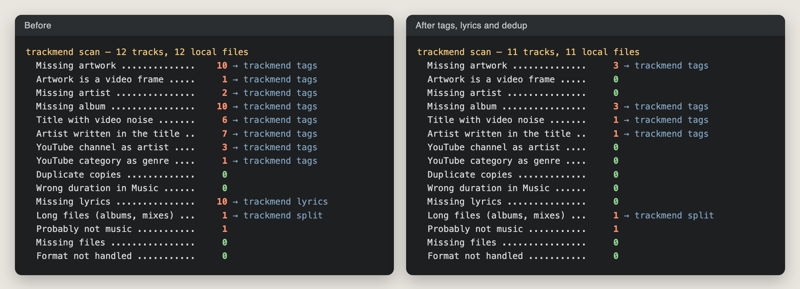

# trackmend

[](https://github.com/Bouliw/trackmend/actions/workflows/ci.yml)

trackmend repairs a macOS Music library full of local files: YouTube rips, old MP3
collections, albums saved as one long file. It cleans the titles, finds the real
artwork, album, year, genre and track number, adds lyrics, removes duplicate copies and
cuts full albums into one track per song.

It works through the Music app itself, not just on a folder of files. It reads the
library from Music, finds each track by its persistent ID, and makes Music take every
change. Every command only shows what it would do until you add `--apply`, every change
is backed up first, and `trackmend undo` puts everything back.

## What it does

| Command | What it does |
|---|---|
| `scan` | Read-only report: missing artwork, artist or album, titles full of video noise, YouTube channels as artists, duplicates, wrong durations, long files, files that are not music |
| `tags` | Cleans the title (`(Official Video)`, `VEVO`, `- Topic`, `Artist - Title`), then finds the track on Deezer and writes the title, artist, album, album artist, year, genre, track number and 1000×1000 artwork |
| `review` | Shows the doubtful matches `tags` did not dare to write, with the old and new artwork side by side, and writes the ones you accept |
| `lyrics` | Adds missing lyrics from [LRCLIB](https://lrclib.net), checked against the duration |
| `dedup` | Finds the same song twice (same artist and title, duration within 4 s) and keeps the best copy (favorite, most played, with lyrics, best bit rate) |
| `split` | Cuts a full album or a mix into tracks, from YouTube chapters, a text track list or a Deezer album lined up on the silences, then replaces the long file in Music |
| `reimport` | Adds again the tracks whose duration Music shows wrongly |
| `undo` | Puts back the tags, artwork, lyrics and tracks a run changed |

It never downloads music. It only works on the files already in your library.

## Report preview

A sample library of twelve YouTube-style files (real names, silent audio), before and
after `tags`, `lyrics` and `dedup`, run against the real Deezer, LRCLIB and iTunes
services (and a YouTube search for the last-resort thumbnail):



What `tags --apply` did on it:

```text
10 tracks to look up
  Bon Iver – Skinny Love (Live) [HD]
      → Bon Iver - Skinny Love (Live)  (cleanup only; the catalogue only has other versions)
  KoЯn - Freak On a Leash (Official HD Video)
      → KoЯn - Freak On a Leash  [Follow The Leader, 1998, artwork: Deezer]  (deezer strong, ±2 s)
  Indila - Dernire danse (Clip officiel)
      → Indila - Dernière danse  [Mini World, 2014, artwork: Deezer]  (deezer strong, ±2 s)
  Youre Beautiful  [James Blunt]
      → James Blunt - You're Beautiful  [Back to Bedlam, 2005, artwork: Deezer]  (deezer strong, ±3 s)
  Kendrick Lamar - HUMBLE. (Official Video)
      → Kendrick Lamar - HUMBLE.  [DAMN., 2017, artwork: Deezer]  (deezer medium, ±13 s)
  Bruxelles arrive  [Roméo Elvis, Le Motel]
      → Roméo Elvis, Le Motel - Bruxelles arrive  (tags unchanged)
      ? artwork to review: YouTube thumbnail of a video of the same length
  Stromae - papaoutai (Official Video)
      → Stromae - Papaoutai  [racine carrée, 2013, artwork: Deezer]  (deezer strong, ±0 s)
  ...
8 matched on Deezer, 1 cleaned only, 0 left as they were, 0 errors (written).
1 doubtful matches wait for you: trackmend review --open
```

What is left after the run is on purpose: the live take keeps its live title and gets no
studio artwork, the only artwork found for one track is a video thumbnail that waits for
`review`, and the full album waits for `split`.

## Installation

You need macOS with the Music app, and Python 3.10 or later.

```sh
brew install pipx ffmpeg      # ffmpeg is only needed by split, reimport and artwork cropping
pipx install git+https://github.com/Bouliw/trackmend.git
```

The first time a command talks to Music, macOS asks whether your terminal may control
Music. Say yes, or allow it later in System Settings > Privacy & Security > Automation.

`split --chapters` with a link also needs [yt-dlp](https://github.com/yt-dlp/yt-dlp)
(`brew install yt-dlp`). It only reads the chapter list; nothing is downloaded.

## Usage

Start with a report. It changes nothing:

```sh
trackmend scan
trackmend scan --details        # list the tracks behind each number
```

Try every command on a small playlist first. Make a playlist in Music, put a few
tracks in it, and add `--playlist`:

```sh
trackmend tags --playlist "trackmend test"            # shows what it would write
trackmend tags --playlist "trackmend test" --apply    # writes what it is sure of
trackmend review --open                                 # the doubtful ones, artwork side by side
trackmend review --accept 1,3 --apply                   # write the ones you checked
trackmend undo --apply                                  # and back
```

Then the whole library, in this order: names first, then artwork (both by `tags`), and
lyrics last, because lyrics are looked up with the artist and the title:

```sh
trackmend tags --apply
trackmend lyrics --apply
trackmend dedup --apply
trackmend split "Discovery (Full Album)" --deezer-album https://www.deezer.com/album/302127 --apply
trackmend split 4F2A0C1B9E77D3A1 --chapters "https://www.youtube.com/watch?v=..." --apply
trackmend split "Live at the Hall" --tracklist tracks.txt --apply
```

When `tags` or `review` later renames a track whose lyrics were not found with its old
names, its lyrics are looked up again right away (`--no-lyrics` turns this off), and
`lyrics` itself looks again at any track renamed since its last search, even by hand.

A track list for `split` has one song per line, with start times (`00:00 Intro`),
durations (`Intro 3:45`) or only titles. With only titles, the cuts go into the
longest silences.

Other useful options:

```sh
trackmend lyrics --track "Bruxelles arrive" --apply  # one track, written at once
trackmend tags --report plan.csv                     # the planned changes as a spreadsheet
trackmend tags --apply --write-via music             # let Music write (see below)
trackmend tags --no-youtube --no-musicbrainz         # fewer sources
trackmend undo --list                                # every run, and what can be undone
```

## Safety

- **Nothing changes without `--apply`.** Without it, every command prints what it would do.
- **Backup first.** Before a file is written, its complete tag block and artwork are saved
  in the run folder (`~/Library/Application Support/trackmend/runs/`).
- **Journal written before and after each change**, flushed to disk, so a crash or a
  power cut never leaves a change that `undo` does not know about.
- **Nothing is deleted.** A track taken out of Music (duplicate, long file that was
  split) has its file moved into the run folder, not to the Trash, and `undo` adds it
  back. Removing tracks always asks for confirmation (or `--yes`).
- **Written as it goes.** Tags and lyrics are written track by track (in batches of ten
  for lyrics), not after an hour of searching. Stop a run at any time: run the same
  command again and it carries on where it stopped.
- **One run at a time.** A lock file stops a second trackmend command from working on
  the library while one is running (`scan` is read-only and can always run).
- **Other scripts.** While another script drives Music through AppleScript,
  `--write-via auto` (the default) asks Music to change the fields and the artwork itself
  instead of writing into the files behind its back.

## How matching works

A local name is first read into an artist, a title and its version words:

- every kind of dash and bar splits the artist from the title (`-`, `–`, `—`, `|`, `//`),
  including `Title - Artist` and `Album - 01. Title`, and `feat`/`ft` with or without a dot;
- YouTube channels in the artist field are recognised (`FooVEVO`, `Foo - Topic`,
  `Foo Official`, `Foo Records`, `COLORS`, `NPR Music`...): the artist then comes from the title;
- version words are kept: live, session, acoustic, remix, cover, demo, edit, sped up...;
  sessions from COLORS, Tiny Desk or KEXP count as live versions.

A Deezer result is accepted only if:

- the artist matches on whole words (a short name like `((( O )))` only matches itself)
  and the title is the same once normalised. Accents lost by old files (`Inachevs`,
  `Youre`) still match, and the catalogue spelling is taken;
- part numbers agree (`Pt. II` is not `Pt. III`);
- it is the same version: a live, remix or sped-up result never replaces a studio file,
  and a live or session file is never given the studio title, album or artwork;
- the duration is within 6 s, or within 45 s with exactly the same title (video versions
  often have a longer intro). Original albums win over compilations;
- tracks with no artist, or whose artist field only held a channel name (`Inconnu`,
  `Lofi Girl`), get a second, stricter pass: same title, duration within 2 s. A known
  artist is never replaced by another one found through the title and the length: a
  cover can be almost as long (`France Gall` would turn into the artist of a cover). The
  same goes for lyrics: those of another artist are never used for a track that has one.

Some matches cannot be trusted on their own, so `tags` never writes them directly:

- the catalogue writes the artist in another script (`福居良` for `Ryo Fukui`). Same title
  and same length are not enough (that is how `Joji` turns into `Gabry Ponte`), so the
  match also needs one of: the same album already in the library, MusicBrainz knowing
  the local name as a name of that artist, or iTunes having the track under the local
  name with the same length (within 3 s);
- the file has no artist and the track was found by title and length only;
- the only artwork found is a video thumbnail.

Without a confirmation they wait for `trackmend review`, which lists them, writes a page
with the current and proposed artwork side by side, and writes only what you accept.
Rejected matches are not proposed again.

The catalogue does not always win. Guests it leaves out are kept in the title, and an
artist credit with more names (`Roméo Elvis, Le Motel`) or a styled spelling (`KoЯn`) is
kept. Katakana readings added to Latin titles are removed. YouTube categories found in
the genre field (`Music`, `People & Blogs`, `Gaming`...) are emptied.

Artwork, when the matched release has none or there is no match:

1. another track of the same album in the library,
2. the album on Deezer, then on the iTunes Search API (US, French and Japanese stores), then
   on MusicBrainz with the Cover Art Archive (1200 px),
3. the same song in another version (artwork only; never for live, session or cover versions),
4. last, the thumbnail of a YouTube video of the same length (found with yt-dlp, which only
   reads the search results), cut to a square and always sent to `review` first.

Artwork that is a frame from a video (16:9 or 4:3, often with black bars) has its bars
removed with ffmpeg's `cropdetect` and is cut to a centred square.

Lyrics come from LRCLIB. When artist and title are exactly the same, a duration gap of up
to two minutes is accepted and the closest version wins (radio edits and video versions
differ from the album). When they only look alike, the duration must agree within 4 s.
A last search is made with the main artist alone and the title without brackets.

## Music app quirks it works around

- `refresh` makes Music read a file's tags again, but it never empties a field that was
  removed from the file and never recomputes the duration. trackmend empties such
  fields through Music directly. `refresh` also crashes when called from JavaScript for
  Automation, so it goes through AppleScript.
- After a new image is written into the file and Music is asked to refresh, the file
  holds the new artwork and AppleScript counts one artwork, yet Music keeps showing the
  image it had in memory (or the grey note). So artwork never relies on `refresh`:
  trackmend hands the image to Music itself (`set data of artwork 1 … as JPEG picture`),
  turning PNG images into JPEG first, and does the same when it undoes a run.
- When "Keep Music Media folder organized" is on, Music renames and moves a file right
  after a refresh, and other scripts may swap a file for another version (`.mp3` for
  `.m4a`). trackmend never keeps a list of paths: it asks Music for a track's location,
  by persistent ID, just before each write, and again for any file that is no longer
  where the export said.
- Some AAC files rewritten by other tools show 0:02 for a four-minute song. `scan` finds
  them (Music's duration against the file's) and `reimport` adds them again, keeping play
  count and favorite.
- Removing a track by script sends its file to the Trash when it sits in the Music
  folder. trackmend moves the file to its run folder first.
- Music cannot read files on the Desktop, in Documents or in Downloads when a script asks
  it to add them. New files are put in `~/Music/trackmend` instead.
- Every command exports the library to its own temporary file, so two scripts never share one.

## How trackmend compares

| | Works on | Lyrics | Tags and artwork | Music app |
|---|---|---|---|---|
| [LRCGET](https://github.com/tranxuanthang/lrcget) | a folder | synced lyrics saved as `.lrc` files next to the music | no | Music does not read `.lrc` files |
| [beets](https://beets.io) + [lyrics plugin](https://beets.readthedocs.io/en/stable/plugins/lyrics.html) | its own database, after importing your collection | LRCLIB, Genius, lrcmux, and more; written to tags if asked | yes (MusicBrainz) | Music does not see the changes until each track is read again |
| [lrxy](https://github.com/pxeemo/lrxy) | files | fetched (LRCLIB, Apple Music, Musixmatch) and embedded, or saved | no | same as above |
| trackmend | the Music library | LRCLIB, written through Music | Deezer and iTunes | reads and writes through Music, by persistent ID |

LRCGET and lrxy are the right tools for a folder of files and synced lyrics. beets is the
right tool to keep a whole collection in order with MusicBrainz. trackmend is for
the case they do not cover: a library that lives in the Music app, where Music keeps its
own copy of every tag and has to be told about each change.

## Data sources

- [Deezer API](https://developers.deezer.com/api): public search, no account or key. Kept
  under 50 requests per 5 seconds; quota errors are retried after a pause.
- [LRCLIB](https://lrclib.net): free and open lyrics database. When it is overloaded it
  answers HTTP 503 at random (it is not a limit per address), so trackmend asks again
  quickly: after 1.5 s, 2.5 s, 3.5 s… up to ten times, then once more at the end of the
  run. A search that still fails is noted "to redo", never "not found", and the next run
  makes it again.
- [iTunes Search API](https://performance-partners.apple.com/search-api): artwork and second
  opinions, about 20 requests per minute, with long pauses after an HTTP 403.
- [MusicBrainz](https://musicbrainz.org/doc/MusicBrainz_API) and the
  [Cover Art Archive](https://coverartarchive.org): artist names in every script and album
  artwork, one request per second.
- YouTube search results, through [yt-dlp](https://github.com/yt-dlp/yt-dlp) when it is
  installed: only for the last-resort thumbnails.

Every answer is cached (`cache.sqlite`), so running a command again does not ask twice.

## Tests

```sh
pip install -e ".[test]"
pytest
```

The tests run on audio files made by ffmpeg on the fly (MP3, AAC and AIFF) and on a stand-in
for the Music app that copies its odd behaviours: `refresh` that keeps emptied fields
and the old artwork on screen, files renamed after a refresh, the Trash on delete, aliases that follow moved files. No
test touches a real library or the network. CI also compiles the AppleScript and
JavaScript files on macOS.

## Limitations

- macOS only: it talks to the Music app. Formats: MP3, AAC/ALAC (`.m4a`) and AIFF.
- Tracks from the Apple Music catalogue or iCloud Music Library uploads are not local
  files and are left alone.
- `reimport` loses the track's place in playlists (Music has no way to keep it).
- `split` cuts without re-encoding, so cuts land on the nearest audio frame (about 26 ms).
- Matching is careful rather than complete: a track left unchanged is better than a
  wrong album. `--retry` looks up the misses again later.

## Development

```sh
git clone https://github.com/Bouliw/trackmend.git
cd trackmend
python3 -m venv .venv && . .venv/bin/activate
pip install -e ".[test]"
pytest
```

Code layout: `text.py` (names, comparison keys), `deezer.py`, `lrclib.py`, `musicbrainz.py`,
`artwork.py`, `youtube.py` (lookups), `confirm.py` (second opinions), `audio.py` (tags,
backups), `music.py` and `osa/` (the Music app), `store.py` (lock, journal, progress), one
module per command.

## License

MIT. Lyrics, artwork and metadata belong to their owners; trackmend only fetches them
for the files in your own library.
